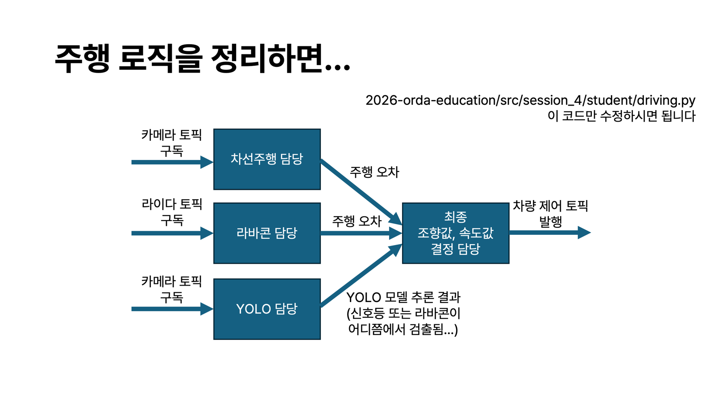

# ORDA 4회차 교육

<details>
<summary>1. 환경 세팅</summary>

3회차 환경을 사용합니다. 모든 명령은 **`2026-orda-education` 폴더의 터미널**에서 실행하세요. Windows는 WSL의 Ubuntu 터미널을 사용합니다.

처음 한 번 실행합니다.

```bash
.venv/bin/python -m pip install -r src/session_4/requirements.txt
```

설치부터 필요하면 [3회차 환경 세팅](SESSION_3.md#1-환경-세팅)을 따라 하세요.

</details>

<details>
<summary>2. 시뮬레이터 켜기 · 수동주행</summary>

**터미널 1:** 시뮬레이터를 켜 둡니다.

```bash
bash scripts/session_4.sh sim
```

**새 터미널:** 키보드로 운전합니다.

```bash
bash scripts/session_4.sh manual
```

운전 창을 클릭하고 **WASD·방향키**로 운전하세요. **Space**는 정지입니다. 자율주행을 시작하기 전에 수동주행 창을 닫으세요.

</details>

<details>
<summary>3. 자율주행 코드 수정</summary>



**4인 1조**로 역할을 나눕니다. 인원이 부족하면 한 사람이 여러 역할을 맡습니다.

수정할 파일은 **`src/session_4/student/driving.py` 하나**입니다. 자기 `TODO`만 수정하고 `DO NOT MODIFY` 아래는 그대로 둡니다. 입력·출력 예시는 코드 주석에 있습니다. 맨 위에는 실제로 사용하는 토픽 구독·발행 코드가 참고용으로 준비되어 있습니다.

- **TODO 1 · `lane(camera)`**: 사진에서 차선을 찾고, 차로 가운데까지의 좌우 오차를 반환합니다.
- **TODO 2 · `rubbercone(lidar)`**: 거리 정보로 양쪽 라바콘을 찾고, 그 사이 가운데까지의 좌우 오차를 반환합니다.
- **TODO 3 · `yolo(labels, bbox, size, conf)`**: 물체 이름·박스 좌표·크기·신뢰도를 받아 신호등·라바콘의 검출 여부, 위치, 박스 크기, 신뢰도를 반환합니다.
- **TODO 4 · `DrivingController.step(lane_result, rubbercone_result, yolo_result)`**: 세 결과로 차선/라바콘 모드, PID 조향, 신호 정지·출발을 결정하고 `[조향각, 속도 PWM]`을 반환합니다.

**코드는 한 명씩 차례로 합칩니다.** 첫 사람이 수정해서 올리면, 다음 사람은 그 코드를 내려받고 자기 TODO를 수정해서 올립니다. 다음 사람도 같은 순서로 반복합니다. 올리기·가져오기 명령은 5번에 있습니다.

Codex·Claude Code에는 아래처럼 요청하세요. `TODO 1`을 자기 번호로 바꿉니다.

```text
src/session_4/student/driving.py의 TODO 1만 구현해줘.
주석의 입력·출력 형식을 지켜줘.
다른 TODO와 DO NOT MODIFY 영역, common 폴더는 수정하지 마.
```

<details>
<summary>꿀팁: bag으로 녹화해 두고 Codex와 디버깅하기</summary>

**bag은 카메라·라이다·조작 기록을 저장한 폴더**입니다. 문제가 난 장면을 저장해 두면 같은 데이터로 코드를 고쳐 가며 비교할 수 있습니다.

**① 녹화하기** — 시뮬레이터를 켜 두고 새 터미널에서 실행합니다.

```bash
bash scripts/session_4.sh record
```

녹화는 켜 둔 채 다른 터미널에서 수동주행(2번) 또는 내 코드(4번)를 실행합니다. 문제가 나타나면 **녹화 터미널에서 `Ctrl+C`**를 눌러 저장을 마칩니다. 저장 위치는 `workspace/session_4/bags/`입니다.

**② 최근 녹화 확인하기** — 녹화가 끝난 뒤 복붙합니다.

```bash
source scripts/session_4_env.sh
BAG_PATH="$(python3 -c 'import json; print(json.load(open("workspace/session_4/latest_bag.json"))["path"])')"
ros2 bag info "$BAG_PATH"
```

**③ Codex에 복붙하기** — `TODO 1`과 마지막 문제 설명만 바꿉니다.

```text
ORDA Session 4의 최근 bag으로 내 코드를 디버깅해줘.
workspace/session_4/latest_bag.json의 path에 있는 bag 폴더를 읽어줘.
나는 src/session_4/student/driving.py의 TODO 1 담당이야.

카메라(/camera/low/image_raw, /camera/high/image_raw), 라이다(/scan),
조작 기록(/session4/motor_control, /session4/manual_control)을 시간순으로 확인해줘.
문제가 난 전후 장면에서 내 함수의 입력과 반환값을 비교해 원인을 찾아줘.
YOLO를 확인할 때는 카메라 영상으로 모델을 추론한 뒤 검출 결과를 yolo 함수에 넣어줘.
내 TODO만 수정하고, 다른 TODO·DO NOT MODIFY·common 폴더는 수정하지 마.
같은 bag으로 수정 전후를 비교하고, 확인한 사실과 추측을 구분해서 설명해줘.
분석 결과와 보조 파일은 workspace/session_4/debug/에 저장해줘.
bag 원본은 보존하고, 분석 중 시뮬레이터나 실제 차량에는 제어 명령을 보내지 마.

문제 상황: 직선인데 차선 오차가 오른쪽으로 크게 나와.
```

bag으로는 **같은 센서 입력에서 함수 결과가 나아졌는지** 확인합니다. 수정 후 실제로 잘 달리는지는 시뮬레이터에서 다시 확인하세요. bag은 Git에 올라가지 않으므로 팀원에게는 폴더 전체를 별도로 공유합니다.

</details>

<details>
<summary>YOLO 담당: 사진 모으고 모델 학습하기</summary>

시뮬레이터를 켜 둔 채 실행합니다. 운전하며 빨강·노랑·초록 신호와 라바콘을 찍고, 창을 닫아 녹화를 마칩니다.

```bash
bash scripts/session_4.sh collect
```

녹화에서 사진을 꺼냅니다. 결과는 `workspace/session_4/extracted/`에 저장됩니다.

```bash
bash scripts/session_4.sh extract
```

[Roboflow](https://app.roboflow.com/)의 **Object Detection** 프로젝트에 사진을 올리고 박스를 칩니다. 이름은 **`red`, `yellow`, `green`, `cone`**을 사용하세요. 신호등은 켜진 램프만, 라바콘은 전체에 박스를 칩니다.

학습용(train)·검증용(valid)을 서로 다른 촬영 구간으로 나누고, 양쪽에 네 종류를 모두 넣습니다. **YOLOv8 형식**으로 내려받아 아래 폴더에 압축을 풉니다.

```bash
mkdir -p workspace/session_4/dataset
```

`workspace/session_4/dataset/data.yaml`이 있는지 확인한 뒤 학습합니다.

```bash
bash scripts/session_4.sh train
```

학습이 끝나면 아래 명령으로 **내 코드와 학습한 모델**을 실행합니다. 학습 결과 `best.pt`는 Git에 올라가지 않으므로 팀원에게 별도로 공유하세요.

```bash
python3 src/session_4/student/driving.py --yolo
```

</details>

</details>

<details>
<summary>4. 내가 짠 코드로 자율주행하기</summary>

시뮬레이터를 켜 두고 **새 터미널**에서 실행합니다.

```bash
python3 src/session_4/student/driving.py
```

현재 기본 코드는 조향 0도·PWM 125로 직진합니다. 코드를 수정하면 **저장 → 실행 중인 터미널에서 `Ctrl+C` → 같은 명령 다시 실행** 순서로 확인하세요. 처음 위치로 돌아가려면 시뮬레이터도 종료하고 다시 켭니다.

</details>

<details>
<summary>5. GitHub에 올리기 · 팀원 코드 가져오기</summary>

**처음 한 번: 로그인하고 초대받기**

```bash
gh auth login
gh auth setup-git
```

`GitHub.com → HTTPS → 브라우저 로그인`을 선택합니다. 오상영에게 GitHub 아이디를 알려 주고 **collaborator 초대**를 요청한 뒤 수락하세요.

**팀 대표만: 팀 브랜치 만들기**

아래 `team-a`를 팀에서 정한 이름으로 바꿉니다. 모든 팀원이 같은 브랜치 이름을 사용합니다.

```bash
TEAM=team-a
git switch -c "$TEAM"
git push -u origin "$TEAM"
```

**가져오기 복붙 — 내 TODO를 수정하기 전에 실행**

`team-a`만 우리 팀 이름으로 바꿉니다. 처음 참여하는 팀원도 이 명령으로 시작합니다.

```bash
TEAM=team-a
git fetch origin
git switch "$TEAM"
git pull --ff-only origin "$TEAM"
```

**올리기 복붙 — 파일 저장 후 실행**

`team-a`와 따옴표 안의 커밋 제목만 바꿉니다. 올린 뒤 다음 팀원에게 내려받으라고 알려 주세요.

```bash
TEAM=team-a
git switch "$TEAM"
git add .
git commit -m "차선 주행 구현"
git push origin "$TEAM"
```

**오류가 뜨면** 실행한 명령과 오류 문장 전체를 Codex·Claude Code에 붙여 넣으세요. “내 TODO와 팀원 TODO를 모두 보존해서 해결해줘”라고 요청합니다.

VS Code의 확장 메뉴에서 OpenAI의 **Codex** 또는 Anthropic의 **Claude Code**를 설치하고 로그인하면 편집기 안에서 질문할 수 있습니다.

</details>

<details>
<summary>6. 정답코드로 주행하기</summary>

시뮬레이터를 켜 두고, 실행 중인 학생 코드는 `Ctrl+C`로 종료합니다. **새 터미널**에서 실행하세요.

```bash
python3 src/session_4/student/driving.py --solution
```

정답 코드와 제공된 YOLO 모델을 사용합니다. **카메라·라이다·주행 설명 창이 자동으로 열립니다.** 창을 닫으면 주행도 종료합니다.

</details>
