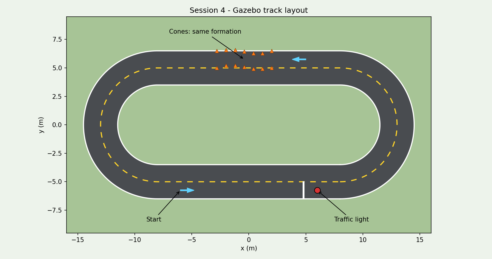

# Session 4

[학생용 안내·복사할 명령어](../../docs/SESSION_4.md)

**학생이 수정하고 실행할 파일은 [student/driving.py](student/driving.py) 하나**입니다. 네 명이 위쪽의 TODO 1~4를 나누어 맡습니다. 아래쪽의 카메라·라이다 자료 수신과 자동차 명령 전송은 완성되어 있습니다. [session_4.code-workspace](session_4.code-workspace)를 VS Code에서 열면 이 파일만 보입니다.

`common/`에는 시뮬레이터·수동주행·녹화·사진 추출·YOLO 학습 등 준비된 코드가 있습니다. 학생은 수정하지 않아도 됩니다. 녹화와 학습 자료는 프로젝트의 `workspace/session_4/`에 모입니다.

프로젝트 폴더의 터미널에서 시뮬레이터를 켭니다.

```bash
bash scripts/session_4.sh sim
```

시뮬레이터를 켜 둔 채 새 터미널에서 학생 파일을 직접 실행합니다.

```bash
python3 src/session_4/student/driving.py
```

수동주행·학습·팀원 코드 공유는 [학생용 안내](../../docs/SESSION_4.md)에 따라 진행합니다.

정답은 `python3 src/session_4/student/driving.py --solution`으로 실행합니다. 제공된 YOLO 모델과 카메라·라이다·주행 설명 창이 함께 켜집니다. 속도 설정은 기존의 2배입니다.

[정답코드](common/solution.py) · [실행 확인 범위](common/VALIDATION.md)


